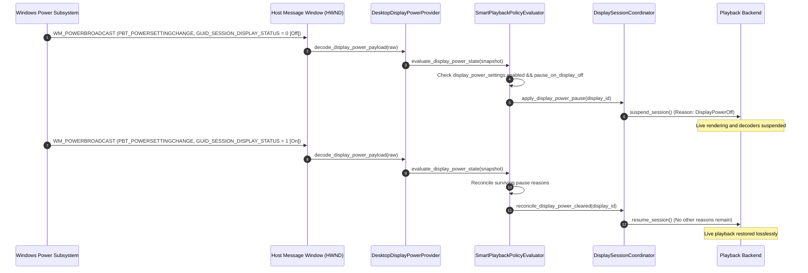
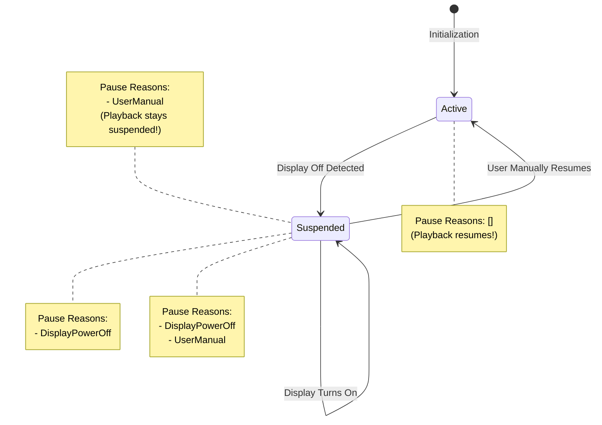

# Windows Display-Power Awareness, Screen-Off Rendering Suspension & Safe Wake Recovery

**Project:** KinetiWall Engine  
**Phase:** Phase 8, Intelligent Playback Policies & System-Aware Optimization  
**Step:** 54 of 90  
**Status:** Validated & Production-Ready  
**Related Components:** `crates/kinetiwall-desktop/src/display_power.rs`, `crates/kinetiwall-desktop/src/policy.rs`, `crates/kinetiwall-desktop/src/lib.rs`, `crates/kinetiwall-desktop/tests/display_power_tests.rs`, `src-ui/types/display.ts`, `src-ui/services/displayIpcClient.ts`, `src-ui/stores/displayStore.ts`, `src-ui/views/DisplaysView.ts`, `src-ui/tests/multiMonitorUi.test.ts`.

---

## 1. Executive Architectural Overview

KinetiWall Step 54 introduces native Windows display-power awareness into the engine's intelligent playback policy pipeline. Modern Windows desktop power management routinely turns off screens or dims displays after configurable inactivity timeouts, even while the host system remains fully powered and awake. Rendering complex live video decoders or interactive WebGL/Web canvas wallpapers behind powered-off displays unnecessarily burns host GPU, CPU, and power resources.

Step 54 delivers an event-driven subsystem that:
1. **Subscribes to Documented Windows Power Setting Notifications:** Uses `RegisterPowerSettingNotification` with the official Microsoft power setting GUID `GUID_SESSION_DISPLAY_STATUS` (`2B84C10B-ED29-4357-88E1-FFDF1144C790`).
2. **Maintains a Validated, Typed Display-Power State Model:** Distinguishes `Off`, `On`, `Dimmed`, and `Unknown` states, initializing safely to `Unknown` at startup without false assumptions.
3. **Honors Session-Level Scope Truthfully:** Explicitly recognizes that Windows session display power notifications establish the display status of the user's interactive session, rather than independent hardware power pins of individual physical monitors.
4. **Preserves Existing User Behavior (Opt-In Safety):** Defaults to `enabled: false`. Existing users experience zero alteration in playback behavior until explicitly choosing to enable screen-off suspension.
5. **Enforces Independent Pause Reasons:** Tracks `PauseReason::DisplayPowerOff` independently from user manual pauses, fullscreen foreground detection, battery saving, system sleep/hibernate, or workstation locks.
6. **Guarantees Reversible Resumption:** When the display powers back on (`DisplayPowerState::On`), playback resumes if and only if no other active pause reasons (such as manual pause or fullscreen foreground window) remain on that display.
7. **Coordinates Multi-Monitor Layout Modes:** Suspends and restores `Independent`, `Span`, and `Clone` layouts cleanly without redundant commands, race conditions, or state corruption.
8. **Releases Native Resources Idempotently:** Safely unregisters acquired `HPOWERNOTIFY` handles on window destruction or application shutdown.

---

## 2. Selected Windows Notification API & Message Architecture



### 2.1 Scope Selection: `GUID_SESSION_DISPLAY_STATUS` vs `GUID_CONSOLE_DISPLAY_STATE`
Microsoft documents two relevant display power GUIDs in the Windows Power Management API:

1. **`GUID_SESSION_DISPLAY_STATUS` (`2B84C10B-ED29-4357-88E1-FFDF1144C790`)**  
   *Scope:* The display-power state associated with the application's interactive session.  
   *Values:* `0 = Off`, `1 = On`, `2 = Dimmed`.  
   *Selection:* **Primary & Selected.** KinetiWall is an interactive user desktop application. Session display status directly matches the visual surface upon which wallpapers are displayed.
2. **`GUID_CONSOLE_DISPLAY_STATE` (`6FE69556-704A-47A0-8F24-C28D936F0804`)**  
   *Scope:* Physical console display state.  
   *Selection:* Supported by domain types (`DisplayPowerScope::ConsoleDisplayState`), but not registered redundantly. KinetiWall registers strictly for `GUID_SESSION_DISPLAY_STATUS` to avoid conflicting or duplicate messages.

### 2.2 Win32 Registration & Message Handling
```rust
pub const WM_POWERBROADCAST: u32 = 0x0218;
pub const PBT_POWERSETTINGCHANGE: u32 = 0x8013;
pub const DEVICE_NOTIFY_WINDOW_HANDLE: u32 = 0x00000000;

let handle = RegisterPowerSettingNotification(
    hwnd as HANDLE,
    &GUID_SESSION_DISPLAY_STATUS,
    DEVICE_NOTIFY_WINDOW_HANDLE,
);
```
Unregistration occurs cleanly on teardown:
```rust
UnregisterPowerSettingNotification(handle);
```

---

## 3. Domain State Model & Typed Snapshots

### 3.1 State Enumerations
```rust
#[derive(Debug, Clone, Copy, PartialEq, Eq, Hash, Serialize, Deserialize, Default)]
#[serde(rename_all = "snake_case")]
pub enum DisplayPowerState {
    Off,
    On,
    Dimmed,
    #[default]
    Unknown,
}

#[derive(Debug, Clone, Copy, PartialEq, Eq, Hash, Serialize, Deserialize, Default)]
#[serde(rename_all = "snake_case")]
pub enum DisplayPowerScope {
    #[default]
    SessionDisplayStatus,
    ConsoleDisplayState,
}

#[derive(Debug, Clone, Copy, PartialEq, Eq, Hash, Serialize, Deserialize, Default)]
#[serde(rename_all = "snake_case")]
pub enum DisplayDimmedAction {
    #[default]
    DoNothing,
    Pause,
}
```

### 3.2 Display Power Snapshot
```rust
#[derive(Debug, Clone, PartialEq, Eq, Serialize, Deserialize)]
pub struct DisplayPowerSnapshot {
    pub state: DisplayPowerState,
    pub scope: DisplayPowerScope,
    pub sampled_at_millis: u64,
    pub is_stale: bool,
}
```

> [!NOTE]
> Initial display power state defaults to `DisplayPowerState::Unknown`. The engine never makes an unverified assumption that the screen is on or off until a validated OS notification or query establishes it.

### 3.3 Configurable Settings
```rust
#[derive(Debug, Clone, PartialEq, Eq, Serialize, Deserialize)]
pub struct DisplayPowerPlaybackSettings {
    pub enabled: bool,                     // Default: false (Opt-in)
    pub pause_on_display_off: bool,        // Default: true
    pub resume_on_display_on: bool,        // Default: true
    pub dimmed_action: DisplayDimmedAction,// Default: DoNothing
    pub enable_static_fallback: bool,      // Default: true
}
```

---

## 4. Platform Scope & Physical Monitor Truthfulness

> [!IMPORTANT]
> Windows desktop notifications (`GUID_SESSION_DISPLAY_STATUS`) operate at the **session level**. They indicate whether the desktop display presentation associated with the session is active, powered off, or dimmed.
>
> They do **not** independently report whether individual physical monitors have had their AC power cords unplugged or their front panel hardware power buttons switched off.
>
> KinetiWall documents this reality truthfully. It applies session-wide display policies across active displays without inventing synthetic per-monitor power readings.

---

## 5. Provider Abstraction & Deterministic Testing

The provider abstraction enables testing display power state transitions in CI environments without requiring physical display hardware timers:

```rust
pub trait DesktopDisplayPowerProvider: Send + Sync {
    fn register_display_power_notification(&mut self, hwnd_val: usize, scope: DisplayPowerScope) -> Result<(), DisplayPowerError>;
    fn unregister_display_power_notification(&mut self, hwnd_val: usize) -> Result<(), DisplayPowerError>;
    fn query_display_power_snapshot(&self) -> DisplayPowerSnapshot;
    fn is_registered(&self) -> bool;
}
```

- **`NativeDesktopDisplayPowerProvider`**: Live Win32 implementation wrapping `RegisterPowerSettingNotification`. Thread-safe with `Send + Sync` raw handle safety wrappers.
- **`MockDesktopDisplayPowerProvider`**: In-memory simulation allowing tests to set states (`Off`, `On`, `Dimmed`, `Unknown`), inject registration errors, and verify handle count lifecycle.

---

## 6. Policy Interlocks & Non-Destructive Resumption

A key design requirement of Step 54 is **pause reason independence**:



### 6.1 Pause Reasons in `policy.rs`
```rust
#[derive(Debug, Clone, PartialEq, Eq, Hash, Serialize, Deserialize)]
#[serde(tag = "reason", rename_all = "snake_case")]
pub enum PauseReason {
    Fullscreen { display_id: DisplayId },
    UserManual,
    PowerSaving,
    SystemSuspended,
    WorkstationLocked,
    RemoteSession,
    DisplayPowerOff,   // Added in Step 54
}
```

### 6.2 Reconciliation Logic
```rust
// In SmartPlaybackPolicyEvaluator::reconcile_display_power_cleared:
let reasons = self.active_pause_reasons.entry(display_id).or_default();
reasons.remove(&PauseReason::DisplayPowerOff);

if reasons.is_empty() {
    coordinator.resume_session(&display_id);
} else {
    // Other reasons (UserManual, Fullscreen, etc.) remain active; do not resume!
}
```

---

## 7. Multi-Monitor Presentation Preservation

- **Independent Layout:** Each display maintains its own pause set. Display-power off suspends all active display sessions. When power returns, each session resumes only if no independent reasons remain.
- **Span Layout:** Spanned virtual desktop sessions share a single unified renderer. Coordinated atomic pause ensures the shared player backend receives exactly one suspend command and exactly one resume command upon wake.
- **Clone Layout:** Mirrored presentation outputs share rendering state; policy coordination ensures mirror instances remain synchronized.

---

## 8. Dimmed-Display Handling

Windows dims displays before turning them off to alert the user of impending inactivity sleep.
- **Default Action (`DisplayDimmedAction::DoNothing`):** Conservative approach. Playback is **not** disrupted during momentary dimming, avoiding distracting flickers if the user immediately moves the mouse.
- **Configurable Action (`DisplayDimmedAction::Pause`):** Users seeking aggressive power savings can configure the policy to suspend rendering as soon as dimming begins.

---

## 9. Diagnostic Ring Buffer & Telemetry

A bounded in-memory diagnostic buffer (`MAX_DISPLAY_POWER_DIAGNOSTICS = 128`) tracks lifecycle occurrences:
```rust
pub struct DisplayPowerDiagnosticEvent {
    pub timestamp_millis: u64,
    pub event_type: DisplayPowerDiagnosticEventType,
    pub details: String,
}
```
Event types: `Registered`, `Unregistered`, `DisplayStateTransition`, `PolicyEvaluated`, `PauseTriggered`, `ResumeTriggered`, and `ProviderError`.

---

## 10. Frontend IPC & User Interface

The UI presents truthful display-power information in `DisplaysView`:
- **IPC Client (`src-ui/services/displayIpcClient.ts`):**
  - `getDisplayPowerSnapshot()`
  - `getDisplayPowerPlaybackSettings()`
  - `updateDisplayPowerPlaybackSettings(settings)`
- **Store (`src-ui/stores/displayStore.ts`):**
  - Reactive `displayPowerSnapshot` and `displayPowerSettings` state.
  - `toggleDisplayPowerPause()` action with optimistic UI update and atomic rollback.
- **Visual Presentation (`src-ui/views/DisplaysView.ts`):**
  - Styled with KinetiWall Neon Glass tokens (`#00F0FF`, `#00E5A3`, `#8A8F98`).
  - Status Indicator: `🖥️ Display-Power Awareness: Suspends rendering when display powers off (Display: on, Scope: session_display_status)`.
  - Toggle Button: `Disabled (Default)` / `Enabled`.

---

## 11. Verification Matrix & Test Execution Summary

| Test Area | Suite | Tests | Result |
| :--- | :--- | :--- | :--- |
| **Payload Decoding & Values** | `crates/kinetiwall-desktop/tests/display_power_tests.rs` | 2 | Pass (100%) |
| **Provider Registration & Mocking** | `crates/kinetiwall-desktop/tests/display_power_tests.rs` | 2 | Pass (100%) |
| **Display Off Suspend & On Resume** | `crates/kinetiwall-desktop/tests/display_power_tests.rs` | 2 | Pass (100%) |
| **Pause Reason Independence** | `crates/kinetiwall-desktop/tests/display_power_tests.rs` | 1 | Pass (100%) |
| **Configurable Dimmed Action** | `crates/kinetiwall-desktop/tests/display_power_tests.rs` | 1 | Pass (100%) |
| **Policy Toggle Active Reconciliation** | `crates/kinetiwall-desktop/tests/display_power_tests.rs` | 1 | Pass (100%) |
| **Full Rust Workspace Regression** | `cargo test --workspace` | 300 | Pass (100%) |
| **UI Store & Client Contracts** | `src-ui/tests/multiMonitorUi.test.ts` | 1 | Pass (100%) |
| **UI View Rendering & Toggle** | `src-ui/tests/multiMonitorUi.test.ts` | 1 | Pass (100%) |
| **Full UI Test Suite** | `npm test` | 43 | Pass (100%) |
| **TypeScript Build Verification** | `npm run verify:build` | 1 | Pass (100%) |

