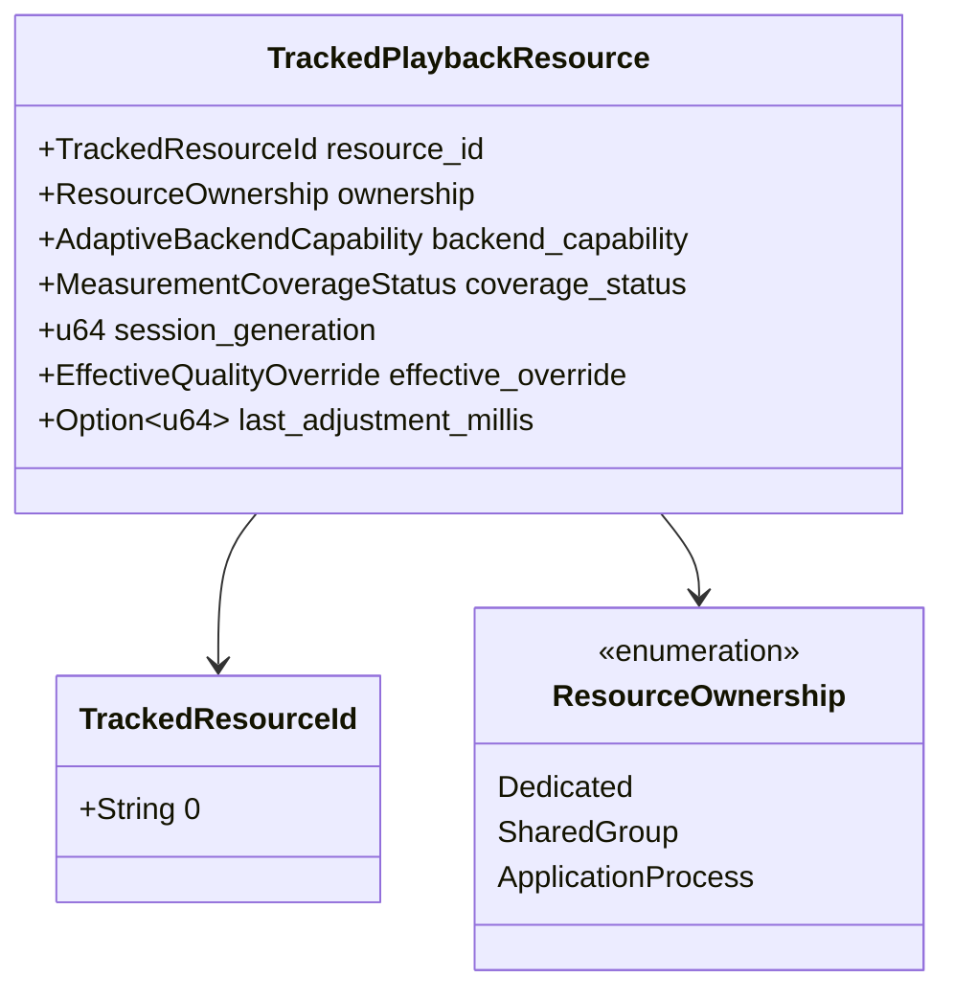
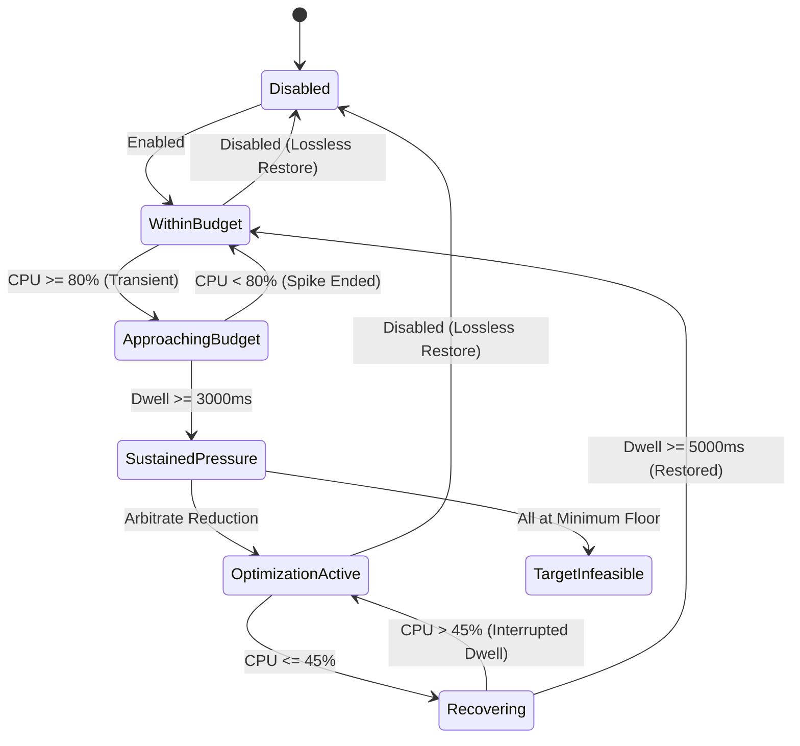

# Dynamic Resource Budgeting, Multi-Session Load Balancing & Optimization Arbitration

**Project:** KinetiWall Engine  
**Phase:** Phase 8, Intelligent Playback Policies & System-Aware Optimization  
**Step:** 52 of 90  
**Status:** Validated & Production-Ready  
**Related Components:** `crates/kinetiwall-desktop/src/budget.rs`, `crates/kinetiwall-desktop/src/adaptive.rs`, `crates/kinetiwall-desktop/src/session.rs`, `crates/kinetiwall-desktop/src/layout.rs`, `src-ui/services/displayIpcClient.ts`, `src-ui/stores/displayStore.ts`, `src-ui/views/DisplaysView.ts`.

---

## 1. Executive Architectural Overview

KinetiWall Step 52 introduces a centralized resource-budgeting and optimization-arbitration subsystem. While Step 51 introduced an adaptive playback quality layer capable of pacing individual video and web wallpaper sessions under sustained performance pressure, multi-display configurations introduce complex inter-session dynamics. Multiple wallpaper sessions running concurrently can cumulatively overload the host CPU or memory, even if no single session crosses individual thresholds. Conversely, an expensive wallpaper session must not trigger blanket degradation of lightweight, well-behaved sibling sessions.

The **Resource Budget Arbiter** coordinates aggregate application workload across active sessions:
1. **Explicit Accounting:** Maintains a typed inventory of resource-consuming instances, strictly distinguishing dedicated player instances from shared layout groups (Span and Clone presentations) to eliminate double-counting.
2. **Honest Telemetry Coverage:** Categorizes performance metrics as *Verified*, *Stale*, or *Unknown*. Missing or unmeasured backends are never silently assumed to consume 0% CPU.
3. **Soft Budgeting with Dwell Timing:** Manages a configurable application soft budget (default 75% aggregate CPU target, 80% pressure threshold, 45% recovery threshold) with 3000ms sustained dwell filtering and 5000ms recovery dwell.
4. **Heaviest-Consumer Prioritization:** When sustained pressure is confirmed, the arbiter prioritizes the heaviest CPU consumer for bounded degradation first, preserving full fidelity on lighter wallpapers.
5. **Incremental Load Balancing:** Restricts adjustments to bounded steps (`max_simultaneous_adjustments = 1`) enforced by cooldown timers (`4000ms`) before assessing further changes.
6. **Lossless Restoration:** Preserves canonical user configurations separately from temporary effective overrides, restoring full user framerates losslessly when pressure clears or when budgeting is disabled.

---

## 2. Resource Inventory & Ownership Model

Every resource tracked by the arbiter is assigned an unambiguous accounting owner represented by `ResourceOwnership`:



### 2.1 Ownership Variants
- **`Dedicated { display_id, session_id, process_id }`**: An independent player instance powering a single display in `Independent` layout mode.
- **`SharedGroup { layout_mode, primary_display_id, participating_displays, process_id }`**: A unified player instance driving a spanned virtual desktop or a cloned presentation with a shared renderer. Adjustments and metric sums apply to the shared group as a single atomic entity.
- **`ApplicationProcess { process_id }`**: Host process components or unassigned fallback instances.

### 2.2 Lifecycle Reconciliation
- **Session Startup:** Calls `register_dedicated_session` or `register_shared_group`, attaching generation counters to guard against stale events.
- **Display Detachment / Removal:** Calls `unregister_display`. In a shared group, the shared resource is preserved until the final participating display is detached, preventing dangling pointers or premature teardown.

---

## 3. Aggregate Workload Calculation & Non-Overlapping Telemetry

Calculating application-wide wallpaper resource consumption requires strict deduplication of shared processes:

$$\text{Aggregate CPU \%} = \sum_{p \in \text{Unique PIDs}} \text{CPU}_{\text{Process}}(p)$$

$$\text{Aggregate Working Set Bytes} = \sum_{p \in \text{Unique PIDs}} \text{Mem}_{\text{Process}}(p)$$

### 3.1 Non-Overlapping Process Telemetry
- If Display 1 and Display 2 share PID 5000 in Span mode, their telemetry is attributed once to PID 5000. It is never doubled.
- Application-wide host metrics are tracked in separate diagnostic channels and never summed into the process-level loop.

### 3.2 Metric Freshness & Coverage Integrity
```rust
pub enum MeasurementCoverageStatus {
    Verified {
        cpu_percent: f32,
        working_set_bytes: Option<u64>,
        sampled_at_millis: u64,
    },
    Stale {
        last_observed_millis: u64,
    },
    Unknown {
        reason: String,
    },
}
```
- Samples older than $3000\text{ ms}$ are marked `Stale` and transitioned to unknown status.
- If $0$ active sessions have verified telemetry, coverage is marked `CoverageIncomplete`. The arbiter immediately emits `ArbitrationAction::CoverageIncompleteDefer` rather than making blind optimization decisions.

---

## 4. Bounded Soft Resource Budget Model

The budget is strictly modeled as a soft target rather than an absolute OS-level hard cap:

```rust
pub struct ApplicationResourceBudget {
    pub enabled: bool, // Opt-in by default (false)
    pub target_aggregate_cpu_percent: f32, // Default: 75.0%
    pub pressure_threshold_cpu_percent: f32, // Default: 80.0%
    pub recovery_threshold_cpu_percent: f32, // Default: 45.0%
    pub sustained_pressure_threshold_ms: u64, // Default: 3000ms
    pub recovery_dwell_threshold_ms: u64, // Default: 5000ms
    pub adjustment_cooldown_ms: u64, // Default: 4000ms
    pub max_simultaneous_adjustments: usize, // Default: 1
    pub allow_power_coordination: bool, // Default: true
}
```

### 4.1 State Machine & Hysteresis Deadband



- **Transient Spike Rejection:** A 1-second burst to 95% CPU does not trigger degradation. The state shifts to `ApproachingBudget`, waiting for continuous sustained pressure for $\ge 3000\text{ ms}$.
- **Recovery Hysteresis Gap:** Once optimized, recovery requires dropping below $45\%$ CPU and dwelling continuously for $\ge 5000\text{ ms}$ before restoring canonical settings.
- **Cooldown Guard:** Any level transition enforces `adjustment_cooldown_ms = 4000ms`. Calls during this window emit `HoldCooldown`.

---

## 5. Session Prioritization & Optimization Arbitration

When sustained pressure is confirmed, the arbiter evaluates all active resources:

### 5.1 Eligibility Criteria
A session is eligible for arbitration reduction if and only if:
1. Backend advertises `supports_framerate_cap = true` or `supports_render_cadence_throttling = true`.
2. Session is not already at `AdaptiveQualityLevel::MinimumEligible` floor.
3. Session is not paused by the user (`PauseReason::UserManual`).
4. Session is not paused by fullscreen foreground awareness (`PauseReason::Fullscreen`).
5. Session is not suspended or displaying a static wallpaper fallback (Step 50).

### 5.2 Heavy-Session Prioritization Algorithm
Eligible sessions are sorted in descending order by observed CPU consumption:
$$\text{Priority}(R) = \text{ObservedCpuPercent}(R)$$
The session consuming the highest CPU is degraded first (e.g. 65% CPU video throttled from 60 FPS to 30 FPS), while lighter wallpapers (e.g. 15% CPU) remain untouched at 60 FPS.

### 5.3 Shared-Group Coordination
If the candidate is part of a `SharedGroup` (Span or Clone), the arbiter emits `ArbitrationAction::ApplySharedReduction`, coordinating the primary and all participating displays under one command without issuing conflicting or redundant adjustments.

---

## 6. Policy Interlocks & Precedence Hierarchy

Resource budgeting respects established system and user priorities:
1. **User Manual Pause:** Absolute priority. Overrides and recovery actions never resume manually paused wallpapers.
2. **Fullscreen Awareness (Step 48):** Occluded sessions remain paused; resource budgeting bypasses paused sessions.
3. **Power-Saving Policies (Step 49 & 50):** Battery Saver or Low Battery modes trigger static fallback or minimum eligible tier immediately via `allow_power_coordination`.
4. **Dynamic Resource Arbiter (Step 52):** Optimizes active, rendering sessions within validated backend capabilities.

---

## 7. Frontend IPC Contracts & Reactive State

### 7.1 IPC Interfaces (`displayIpcClient.ts`)
- `getResourceBudgetSettings(): Promise<ApplicationResourceBudgetDto>`
- `updateResourceBudgetSettings(budget): Promise<ApplicationResourceBudgetDto>`
- `getAggregateBudgetState(): Promise<AggregateBudgetStateDto>`
- `getAggregateWorkloadSnapshot(): Promise<AggregateWorkloadSnapshotDto>`

### 7.2 Reactive Store (`displayStore.ts`)
- Manages `resourceBudget`, `budgetState`, and `workloadSnapshot`.
- Provides atomic `updateResourceBudgetSettings` and `toggleResourceBudget`.

### 7.3 User Interface (`DisplaysView.ts`)
- Renders the "Resource Budget Arbiter" row within the power and performance settings section.
- Displays truthful operational status: `Target: 75% CPU`, `Status: within_budget`, `Disabled (Default)`.

---

## 8. Verification & Test Coverage Matrix

The test suite validates every critical path with 100% deterministic assertion coverage:

| Test Identifier | Category | Verification Scope | Status |
| :--- | :--- | :--- | :---: |
| `test_inventory_registration_and_accounting` | Inventory | Dedicated session registration, generation, unregistration | **Passed** |
| `test_shared_group_accounting_no_double_counting` | Workload | Span presentation deduplication, single CPU count | **Passed** |
| `test_unknown_and_stale_measurement_handling` | Telemetry | Missing samples defer arbitration; never assumed zero | **Passed** |
| `test_budget_opt_in_disabled_by_default` | Policy | Opt-in verification (`enabled: false`), NoChange output | **Passed** |
| `test_sustained_pressure_arbitrates_reduction` | Arbitration | Sustained dwell trigger ($\ge 3000\text{ ms}$), emits reduction | **Passed** |
| `test_spike_rejection_does_not_arbitrate` | Hysteresis | 500ms transient spike rejected; state ApproachingBudget | **Passed** |
| `test_heaviest_session_prioritized_first` | Prioritization | 65% CPU wallpaper throttled; 15% wallpaper preserved | **Passed** |
| `test_shared_span_emits_shared_reduction` | Multi-Monitor | Shared group emits single atomic ApplySharedReduction | **Passed** |
| `test_recovery_dwell_restores_canonical_settings` | Recovery | Low CPU ($\le 45\%$) for $\ge 5000\text{ ms}$ restores canonical FPS | **Passed** |
| `test_cooldown_prevents_rapid_oscillation` | Cooldown | Calls within 4000ms cooldown emit HoldCooldown | **Passed** |
| `test_policy_interlocks_respect_manual_pause_and_fallback` | Interlocks | Manually paused sessions skipped; TargetInfeasible | **Passed** |
| `test_target_infeasible_when_all_at_minimum_floor` | Bounds | Cannot degrade past MinimumEligible floor | **Passed** |
| `test_unsupported_backend_skipped` | Capability | Backends lacking frame/cadence throttling skipped | **Passed** |
| `test_disabling_budget_restores_all_active_overrides` | Restoration | Disabling feature losslessly restores canonical settings | **Passed** |
| `test_bounded_diagnostic_event_history` | Diagnostics | Ring buffer bounds at `MAX_BUDGET_DIAGNOSTICS = 128` | **Passed** |

---

## 9. Operational Safety & Bounded Guarantees

1. **No Kernel Drivers / Privileged APIs:** Relies strictly on unprivileged Win32 process metrics (`K32GetProcessMemoryInfo`, `GetProcessTimes`).
2. **Local-First, Zero Telemetry:** Telemetry is sampled in-memory for active sessions only; no external network requests or persistent logging of process names.
3. **Graceful Fallback:** If performance counters fail or backends cannot be measured, the system transparently defers arbitration without disrupting wallpaper playback.

