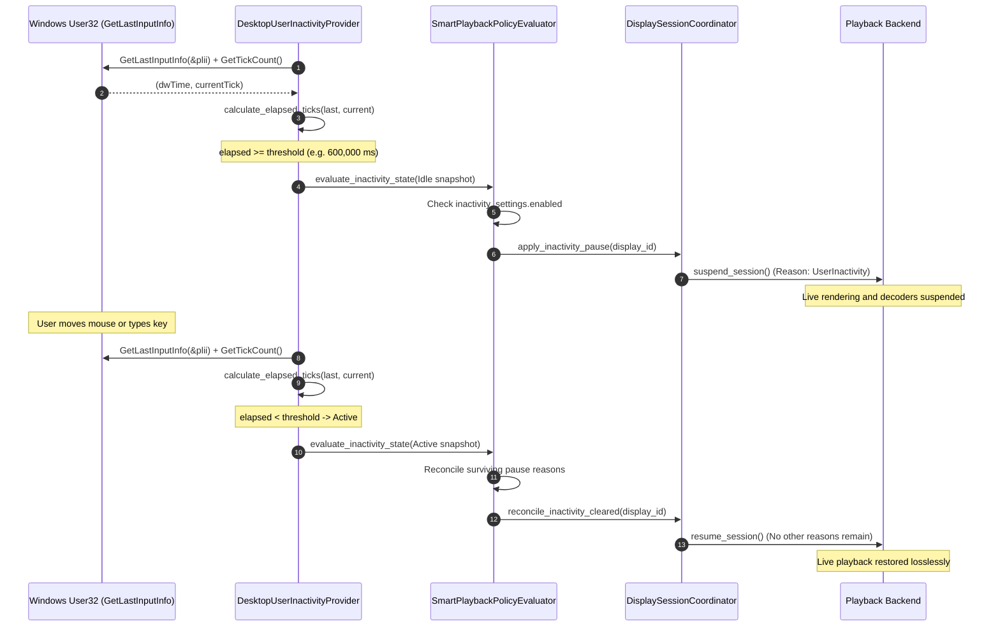
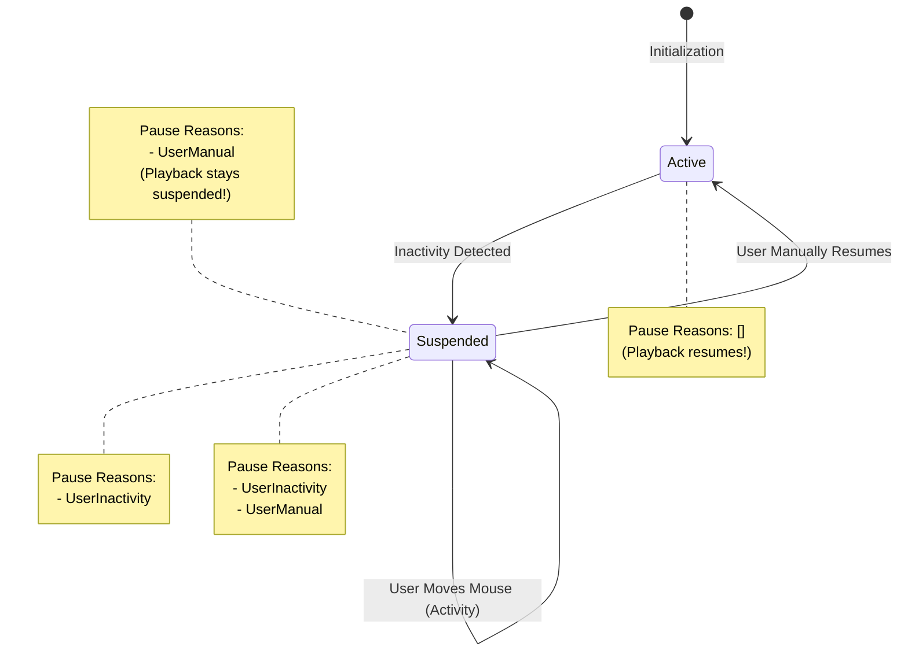

# Windows User-Inactivity Awareness, Idle Detection & Privacy-Preserving Playback Policies

**Project:** KinetiWall Engine  
**Phase:** Phase 8, Intelligent Playback Policies & System-Aware Optimization  
**Step:** 55 of 90  
**Status:** Validated & Production-Ready  
**Related Components:** `crates/kinetiwall-desktop/src/inactivity.rs`, `crates/kinetiwall-desktop/src/policy.rs`, `crates/kinetiwall-desktop/src/lib.rs`, `crates/kinetiwall-desktop/tests/inactivity_tests.rs`, `src-ui/types/display.ts`, `src-ui/services/displayIpcClient.ts`, `src-ui/stores/displayStore.ts`, `src-ui/views/DisplaysView.ts`, `src-ui/tests/multiMonitorUi.test.ts`.

---

## 1. Executive Architectural Overview

KinetiWall Step 55 introduces session-level user-inactivity awareness into the desktop host engine. In desktop and workstation environments, users frequently step away from their desks or leave workstations unattended without locking the screen or waiting for display sleep timeouts. Rendering high-framerate video wallpapers or complex 3D WebGL canvases when no user interaction is taking place consumes host GPU, CPU, and power.

Step 55 equips KinetiWall with the ability to:
1. **Detect Session Input Inactivity Accurately:** Uses the documented Win32 `GetLastInputInfo` API to determine elapsed session idle time from system boot tick counts.
2. **Uphold Absolute Privacy Preservation:** Strictly queries the operating system's single `dwTime` tick count. The engine **never** installs keyboard or mouse hooks, never inspects keystrokes, never records cursor coordinates, and never logs foreground window titles or user activity histories.
3. **Handle Tick Rollover Mathematically:** Correctly handles 32-bit tick count wraparound (`GetTickCount` wraps past 0 approximately every 49.7 days) to prevent underflow or fabricated durations.
4. **Preserve Existing User Behavior (Opt-In Safety):** Defaults to `enabled: false`. Existing users experience zero alteration in wallpaper playback until explicitly opting in.
5. **Enforce Independent Pause Reasons:** Tracks `PauseReason::UserInactivity` independently from user manual pauses, fullscreen foreground detection, battery saving, system sleep/hibernate, workstation locks, or display-power off states.
6. **Guarantee Reversible Resumption:** When qualifying session input returns, playback resumes if and only if no other active pause reasons (such as manual pause or fullscreen foreground window) remain on that display.
7. **Coordinate Multi-Monitor Layout Modes:** Coordinates suspension and restoration across `Independent`, `Span`, and `Clone` layouts cleanly without redundant commands, race conditions, or state corruption.
8. **Provide Bounded In-Memory Diagnostics:** Retains a bounded diagnostic history (`MAX_INACTIVITY_DIAGNOSTICS = 128`) for debugging without logging sensitive input events.

---

## 2. Selected Windows API & Tick-Count Arithmetic



### 2.1 API Declaration & Semantics
`GetLastInputInfo` retrieves the time of the last input event across keyboard, mouse, touch, or pen input for the caller's desktop session:

```c
typedef struct tagLASTINPUTINFO {
    UINT  cbSize;
    DWORD dwTime;
} LASTINPUTINFO, *PLASTINPUTINFO;

BOOL GetLastInputInfo(PLASTINPUTINFO plii);
```

### 2.2 Tick-Count Rollover Arithmetic
The `dwTime` member is a 32-bit unsigned integer representing milliseconds elapsed since system boot. To avoid overflow or underflow when `GetTickCount` wraps past $2^{32}-1$ (every ~49.7 days), KinetiWall implements:

```rust
pub fn calculate_elapsed_ticks(last_input_tick: u32, current_tick: u32) -> u64 {
    if current_tick >= last_input_tick {
        u64::from(current_tick - last_input_tick)
    } else {
        // Wraparound occurred (current_tick wrapped back past 0)
        let before_wrap = u64::from(u32::MAX - last_input_tick);
        let after_wrap = u64::from(current_tick);
        before_wrap.saturating_add(after_wrap).saturating_add(1)
    }
}
```

---

## 3. Privacy Preservation Guarantees

> [!IMPORTANT]
> KinetiWall is designed with privacy as a foundational requirement:
> 1. **No Keystroke Logging:** The engine never intercepts, inspects, or logs keystrokes or key codes.
> 2. **No Pointer Tracking:** Mouse cursor coordinates, movement vectors, and clicks are never captured.
> 3. **No Screen Capture:** Screenshots, window contents, and desktop surfaces are never inspected.
> 4. **No Process Profiling:** Application titles and user browsing histories are never recorded.
> 5. **Local Execution Only:** Session input timestamps are queried and processed entirely locally on the device; no telemetry or activity timestamps are sent to cloud services.

---

## 4. Domain State Model & Typed Snapshots

### 4.1 State Enumeration
```rust
#[derive(Debug, Clone, Copy, PartialEq, Eq, Hash, Serialize, Deserialize, Default)]
#[serde(rename_all = "snake_case")]
pub enum InactivityState {
    Active,
    Idle,
    Transitioning,
    #[default]
    Unknown,
    Stale,
}
```

### 4.2 Inactivity Snapshot
```rust
#[derive(Debug, Clone, PartialEq, Eq, Serialize, Deserialize)]
pub struct InactivitySnapshot {
    pub state: InactivityState,
    pub elapsed_inactivity_millis: u64,
    pub idle_threshold_millis: u64,
    pub sampled_at_millis: u64,
    pub is_fresh: bool,
}
```

### 4.3 Configurable Settings
```rust
pub const DEFAULT_INACTIVITY_THRESHOLD_MILLIS: u64 = 600_000; // 10 minutes
pub const MIN_INACTIVITY_THRESHOLD_MILLIS: u64 = 10_000;      // 10 seconds
pub const MAX_INACTIVITY_THRESHOLD_MILLIS: u64 = 86_400_000;  // 24 hours

#[derive(Debug, Clone, PartialEq, Eq, Serialize, Deserialize)]
pub struct InactivityPlaybackSettings {
    pub enabled: bool,                     // Default: false (Opt-in)
    pub idle_threshold_millis: u64,        // Default: 600,000 ms
    pub resume_on_activity: bool,          // Default: true
    pub enable_static_fallback: bool,      // Default: true
}
```

---

## 5. Provider Abstraction & Safe Mocking

The provider abstraction allows testing inactivity and rollover deterministically in CI environments:

```rust
pub trait DesktopUserInactivityProvider: Send + Sync {
    fn query_last_input_ticks(&self) -> Result<(u32, u32), InactivityError>;
    fn query_inactivity_snapshot(&self, threshold_millis: u64) -> InactivitySnapshot;
}
```

- **`NativeDesktopUserInactivityProvider`**: Invokes Win32 `GetLastInputInfo` and `GetTickCount`.
- **`MockDesktopUserInactivityProvider`**: In-memory simulation allowing tests to advance time, record synthetic user inputs, simulate tick rollovers, and inject query failures.

---

## 6. Policy Interlocks & Non-Destructive Resumption

A central architectural mandate of KinetiWall is **pause reason independence**:



### 6.1 Pause Reasons in `policy.rs`
```rust
#[derive(Debug, Clone, PartialEq, Eq, Hash, Serialize, Deserialize)]
#[serde(tag = "reason", rename_all = "snake_case")]
pub enum PauseReason {
    Fullscreen { display_id: DisplayId },
    UserManual,
    PowerSaving,
    SystemSuspended,
    WorkstationLocked,
    RemoteSession,
    DisplayPowerOff,
    UserInactivity,    // Added in Step 55
}
```

### 6.2 Reconciliation Logic
```rust
// In SmartPlaybackPolicyEvaluator::reconcile_inactivity_cleared:
let reasons = self.active_pause_reasons.entry(display_id).or_default();
reasons.remove(&PauseReason::UserInactivity);

if reasons.is_empty() {
    coordinator.resume_session(&display_id);
} else {
    // Surviving reasons (e.g. UserManual, Fullscreen, PowerSaving) keep session suspended!
}
```

---

## 7. Multi-Monitor Presentation Preservation

- **Independent Layout:** Inactivity is evaluated at the interactive session level. Suspending applies `PauseReason::UserInactivity` to all active display sessions. When activity resumes, each session evaluates its own pause reasons independently.
- **Span Layout:** Spanned virtual desktop sessions share a single unified player instance. Coordinated pause ensures the shared player backend receives exactly one suspend command and exactly one resume command upon activity.
- **Clone Layout:** Mirrored presentation outputs share rendering state; policy coordination ensures mirror instances remain synchronized.

---

## 8. Diagnostic Ring Buffer & Telemetry

A bounded in-memory diagnostic buffer (`MAX_INACTIVITY_DIAGNOSTICS = 128`) tracks lifecycle occurrences:
```rust
pub struct InactivityDiagnosticEvent {
    pub timestamp_millis: u64,
    pub event_type: InactivityDiagnosticEventType,
    pub details: String,
}
```
Event types: `ObservationQueried`, `IdleThresholdReached`, `ActivityResumed`, `PolicyApplied`, `PolicyCleared`, and `ProviderError`.

---

## 9. Frontend IPC & User Interface

The UI presents truthful inactivity information in `DisplaysView`:
- **IPC Client (`src-ui/services/displayIpcClient.ts`):**
  - `getInactivitySnapshot()`
  - `getInactivityPlaybackSettings()`
  - `updateInactivityPlaybackSettings(settings)`
- **Store (`src-ui/stores/displayStore.ts`):**
  - Reactive `inactivitySnapshot` and `inactivitySettings` state.
  - `toggleInactivityPause()` action with optimistic UI update and atomic rollback.
- **Visual Presentation (`src-ui/views/DisplaysView.ts`):**
  - Styled with KinetiWall Neon Glass tokens (`#00F0FF`, `#00E5A3`, `#8A8F98`).
  - Status Indicator: `⏳ User-Inactivity Awareness: Pauses playback on session idle (State: active, Threshold: 10m)`.
  - Toggle Button: `Disabled (Default)` / `Enabled`.

---

## 10. Verification Matrix & Test Execution Summary

| Test Area | Suite | Tests | Result |
| :--- | :--- | :--- | :--- |
| **Elapsed Tick & Rollover Math** | `crates/kinetiwall-desktop/tests/inactivity_tests.rs` | 1 | Pass (100%) |
| **Snapshot Defaults & Construction** | `crates/kinetiwall-desktop/tests/inactivity_tests.rs` | 1 | Pass (100%) |
| **Opt-in Default Evaluation** | `crates/kinetiwall-desktop/tests/inactivity_tests.rs` | 1 | Pass (100%) |
| **Mock Provider & Query Errors** | `crates/kinetiwall-desktop/tests/inactivity_tests.rs` | 1 | Pass (100%) |
| **Inactivity Suspend & Activity Resume**| `crates/kinetiwall-desktop/tests/inactivity_tests.rs` | 2 | Pass (100%) |
| **Pause Reason Independence** | `crates/kinetiwall-desktop/tests/inactivity_tests.rs` | 1 | Pass (100%) |
| **Threshold Clamping (10s .. 24h)** | `crates/kinetiwall-desktop/tests/inactivity_tests.rs` | 1 | Pass (100%) |
| **Policy Toggle Active Reconciliation** | `crates/kinetiwall-desktop/tests/inactivity_tests.rs` | 1 | Pass (100%) |
| **Full Rust Workspace Regression** | `cargo test --workspace` | 309 | Pass (100%) |
| **UI Store & Client Contracts** | `src-ui/tests/multiMonitorUi.test.ts` | 1 | Pass (100%) |
| **UI View Rendering & Toggle** | `src-ui/tests/multiMonitorUi.test.ts` | 1 | Pass (100%) |
| **Full UI Test Suite** | `npm test` | 45 | Pass (100%) |
| **TypeScript Build Verification** | `npm run verify:build` | 1 | Pass (100%) |

