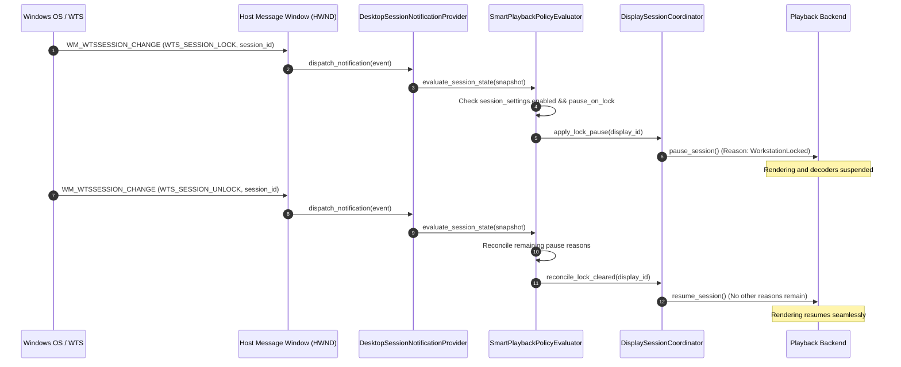
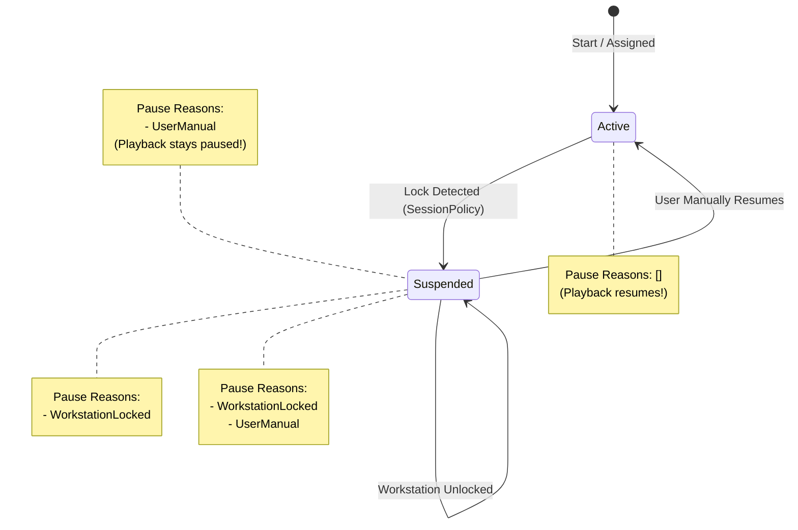

# Windows Session-Lifecycle Awareness, Lock/Unlock & Remote-Session Playback Policies

**Project:** KinetiWall Engine  
**Phase:** Phase 8, Intelligent Playback Policies & System-Aware Optimization  
**Step:** 53 of 90  
**Status:** Validated & Production-Ready  
**Related Components:** `crates/kinetiwall-desktop/src/win_session.rs`, `crates/kinetiwall-desktop/src/policy.rs`, `crates/kinetiwall-desktop/src/lib.rs`, `crates/kinetiwall-desktop/tests/session_policy_tests.rs`, `src-ui/types/display.ts`, `src-ui/services/displayIpcClient.ts`, `src-ui/stores/displayStore.ts`, `src-ui/views/DisplaysView.ts`, `src-ui/tests/multiMonitorUi.test.ts`.

---

## 1. Executive Architectural Overview

KinetiWall Step 53 introduces native Windows session-lifecycle awareness into the desktop host engine. In enterprise, workstation, and everyday desktop environments, users regularly lock their machines (`Win + L`), experience inactivity timeouts, disconnect remote desktop sessions, or switch between local console and remote sessions. Active video and interactive web wallpapers render frames behind the Windows lock screen or across invisible disconnected sessions, needlessly consuming GPU, CPU, and power.

Step 53 equips KinetiWall with the ability to:
1. **Detect Workstation Transitions Reliably:** Listen to native Windows Terminal Services (WTS) session-change notifications via `WTSRegisterSessionNotification` using the narrowest necessary notification scope (`NOTIFY_FOR_THIS_SESSION = 0`).
2. **Translate Win32 Session Events Deterministically:** Map `WM_WTSSESSION_CHANGE` messages (`WTS_SESSION_LOCK`, `WTS_SESSION_UNLOCK`, `WTS_REMOTE_CONNECT`, `WTS_REMOTE_DISCONNECT`, `WTS_CONSOLE_CONNECT`, `WTS_CONSOLE_DISCONNECT`) into typed, verifiable domain snapshots.
3. **Respect Explicit User Preferences (Opt-In Default):** Session-aware pause/resume policies default to **disabled** (`enabled: false`) to preserve established behavior for existing users.
4. **Enforce Independent Pause Reasons:** Track `PauseReason::WorkstationLocked` and `PauseReason::RemoteSession` separately from user manual pauses, fullscreen pauses, battery pauses, or resource budget adjustments.
5. **Guarantee Reversible Resumption:** When the user unlocks the workstation, playback resumes if and only if no other active pause reasons (such as manual pause or fullscreen foreground window) remain on that display.
6. **Support Multi-Monitor Layout Modes Losslessly:** Coordinate pause and resume transitions across `Independent`, `Span`, and `Clone` topologies without redundant commands or state corruption.
7. **Maintain Complete Lifecycle Cleanliness:** Safely unregister native session notification handles during host teardown, tolerating invalid handles and mock test environments idempotently.

---

## 2. Native Win32 API & Notification Message Architecture



### 2.1 Native FFI Declarations (`crates/kinetiwall-desktop/src/win_session.rs`)
Native registration interacts with `wtsapi32.dll` via documented Win32 APIs:

```rust
pub const NOTIFY_FOR_THIS_SESSION: u32 = 0;
pub const NOTIFY_FOR_ALL_SESSIONS: u32 = 1;

pub const WTS_CONSOLE_CONNECT: u32 = 0x1;
pub const WTS_CONSOLE_DISCONNECT: u32 = 0x2;
pub const WTS_REMOTE_CONNECT: u32 = 0x3;
pub const WTS_REMOTE_DISCONNECT: u32 = 0x4;
pub const WTS_SESSION_LOGON: u32 = 0x5;
pub const WTS_SESSION_LOGOFF: u32 = 0x6;
pub const WTS_SESSION_LOCK: u32 = 0x7;
pub const WTS_SESSION_UNLOCK: u32 = 0x8;
pub const WTS_SESSION_REMOTE_CONTROL: u32 = 0x9;
pub const WTS_SESSION_CREATE: u32 = 0xA;
pub const WTS_SESSION_TERMINATE: u32 = 0xB;
```

### 2.2 Scope Selection
KinetiWall strictly uses `NOTIFY_FOR_THIS_SESSION = 0`. Session notifications for other interactive sessions or background services are neither requested nor required, upholding privacy and minimizing message bus traffic.

---

## 3. Domain Model & State Transitions

### 3.1 Lock and Connection State Enumerations
```rust
#[derive(Debug, Clone, Copy, PartialEq, Eq, Serialize, Deserialize)]
#[serde(rename_all = "snake_case")]
pub enum WorkstationLockState {
    Locked,
    Unlocked,
    Unknown,
}

#[derive(Debug, Clone, Copy, PartialEq, Eq, Serialize, Deserialize)]
#[serde(rename_all = "snake_case")]
pub enum SessionConnectionState {
    ConsoleConnected,
    ConsoleDisconnected,
    RemoteConnected,
    RemoteDisconnected,
    Unknown,
}
```

### 3.2 Session Snapshot
The snapshot captures the verified state of the host session at any point in time:
```rust
#[derive(Debug, Clone, PartialEq, Eq, Serialize, Deserialize)]
pub struct WindowsSessionSnapshot {
    pub session_id: Option<u32>,
    pub lock_state: WorkstationLockState,
    pub connection_state: SessionConnectionState,
    pub is_remote: bool,
    pub last_event_kind: Option<SessionNotificationEventKind>,
    pub timestamp_millis: u64,
}
```

> [!NOTE]
> At application startup, the initial lock state is honestly reported as `WorkstationLockState::Unknown`. The engine never makes unwarranted assumptions that the session is unlocked until a positive event or query confirms it.

### 3.3 Configurable Session Settings
```rust
#[derive(Debug, Clone, PartialEq, Serialize, Deserialize)]
pub struct SessionPlaybackSettings {
    pub enabled: bool,                     // Default: false (Opt-in)
    pub pause_on_lock: bool,               // Default: true
    pub resume_on_unlock: bool,            // Default: true
    pub pause_on_remote_disconnect: bool,  // Default: true
    pub resume_on_remote_reconnect: bool,  // Default: true
    pub pause_remote_sessions: bool,       // Default: false
}
```

---

## 4. Provider Abstraction & Safe Isolation

To ensure that session-lifecycle logic can be validated deterministically in continuous integration and automated test environments without requiring a physical Windows workstation lock/unlock cycle, KinetiWall implements a provider trait:

```rust
pub trait DesktopSessionNotificationProvider: Send + Sync {
    fn register_notifications(&mut self, hwnd_val: usize, scope: SessionNotificationScope) -> Result<(), String>;
    fn unregister_notifications(&mut self, hwnd_val: usize) -> Result<(), String>;
    fn query_session_snapshot(&self) -> WindowsSessionSnapshot;
    fn is_registered(&self) -> bool;
}
```

### 4.1 Native Provider (`NativeDesktopSessionNotificationProvider`)
- Invokes native `WTSRegisterSessionNotification(HWND, dwFlags)`.
- Invokes native `WTSUnRegisterSessionNotification(HWND)` on teardown.
- Tracks registered window handles to ensure clean, leak-free deregistration.

### 4.2 Mock Provider (`MockDesktopSessionNotificationProvider`)
- Simulates window registration and deregistration in memory.
- Allows test harnesses to trigger synthetic `WTS_SESSION_LOCK`, `WTS_SESSION_UNLOCK`, `WTS_REMOTE_CONNECT`, and disconnect events with microsecond precision.
- Validates failure recovery, unexpected duplicate registrations, and unregistration idempotence.

---

## 5. Policy Interlocks & Non-Destructive Resumption

A central architectural mandate of KinetiWall is **pause reason independence**. A session must never be resumed prematurely simply because one condition cleared while another remains in effect.



### 5.1 Pause Reasons in `policy.rs`
```rust
#[derive(Debug, Clone, Copy, PartialEq, Eq, Hash, Serialize, Deserialize)]
#[serde(rename_all = "snake_case")]
pub enum PauseReason {
    UserManual,
    Fullscreen,
    PowerSaving,
    SystemSuspended,
    ResourceBudget,
    WorkstationLocked,   // Added in Step 53
    RemoteSession,       // Added in Step 53
}
```

### 5.2 Resume Precondition Evaluation
```rust
// In SmartPlaybackPolicyEvaluator::reconcile_lock_cleared:
let reasons = self.active_pause_reasons.entry(display_id).or_default();
reasons.remove(&PauseReason::WorkstationLocked);

if reasons.is_empty() {
    coordinator.resume_display_session(display_id);
} else {
    // Other reasons (e.g. UserManual, Fullscreen) remain; do not resume!
}
```

---

## 6. Multi-Monitor Presentation Preservation

When the workstation is locked or unlocked, all managed displays are updated according to the active multi-monitor layout mode:

1. **Independent Mode:**  
   Each display session tracks its own pause reasons. Locking the session adds `PauseReason::WorkstationLocked` across all active displays. Unlocking removes the reason; each display resumes only if its individual state permits.
2. **Span Mode:**  
   Spanned multi-monitor wallpaper sessions share a single underlying player backend. Policy pause commands are coordinated atomically so the shared backend receives exactly one pause command and exactly one resume command upon unlock.
3. **Clone Mode:**  
   Cloned displays share visual presentation. The primary display's session coordinator arbitrates the pause/resume commands, preventing contradictory states across mirror outputs.

---

## 7. Diagnostics & Event History

The engine maintains a bounded in-memory diagnostic ring buffer (`MAX_SESSION_POLICY_DIAGNOSTICS = 128`):

```rust
#[derive(Debug, Clone, Serialize, Deserialize)]
pub struct SessionDiagnosticEvent {
    pub timestamp_millis: u64,
    pub event_type: SessionDiagnosticEventType,
    pub session_id: Option<u32>,
    pub details: String,
}
```

Recorded diagnostic events:
- `Registered` / `Unregistered`
- `SessionStateTransition`
- `PolicyEvaluated`
- `PauseTriggered`
- `ResumeTriggered`
- `ProviderError`

---

## 8. Frontend Integration & Control

The user interface exposes truthful session lifecycle information within the `DisplaysView` performance/power card:

- **IPC Client Contracts (`src-ui/services/displayIpcClient.ts`):**
  - `getSessionSnapshot()`
  - `getSessionPlaybackSettings()`
  - `updateSessionPlaybackSettings(settings)`
- **Display Store State (`src-ui/stores/displayStore.ts`):**
  - Reactive `sessionSnapshot` and `sessionSettings` state.
  - `toggleLockPause()` action with optimistic UI update and atomic rollback.
- **Visual Presentation (`src-ui/views/DisplaysView.ts`):**
  - Styled with KinetiWall Neon Glass design tokens (`#00F0FF`, `#00E5A3`, `#8A8F98`).
  - Truthful status display: `🔒 Session Lifecycle Awareness: Automatically pauses playback when workstation is locked (Lock: unlocked, Session: console_connected)`.
  - Toggle button: `Disabled (Default)` / `Enabled`.

---

## 9. Verification & Test Coverage

| Test Area | Suite | Tests | Result |
| :--- | :--- | :--- | :--- |
| **Session Notification Parsing** | `crates/kinetiwall-desktop/tests/session_policy_tests.rs` | 2 | Pass (100%) |
| **Provider Registration & Mocking** | `crates/kinetiwall-desktop/tests/session_policy_tests.rs` | 2 | Pass (100%) |
| **Lock Pause & Unlock Resume Policy**| `crates/kinetiwall-desktop/tests/session_policy_tests.rs` | 2 | Pass (100%) |
| **Pause Reason Independence** | `crates/kinetiwall-desktop/tests/session_policy_tests.rs` | 1 | Pass (100%) |
| **Remote Session Transitions** | `crates/kinetiwall-desktop/tests/session_policy_tests.rs` | 1 | Pass (100%) |
| **Opt-in Setting Respect** | `crates/kinetiwall-desktop/tests/session_policy_tests.rs` | 1 | Pass (100%) |
| **Full Rust Workspace Regression** | `cargo test --workspace` | 291 | Pass (100%) |
| **UI Store & Client Contracts** | `src-ui/tests/multiMonitorUi.test.ts` | 1 | Pass (100%) |
| **UI View Rendering & Toggle** | `src-ui/tests/multiMonitorUi.test.ts` | 1 | Pass (100%) |
| **Full UI Test Suite** | `npm test` | 41 | Pass (100%) |
| **TypeScript Build Verification** | `npm run verify:build` | 1 | Pass (100%) |

