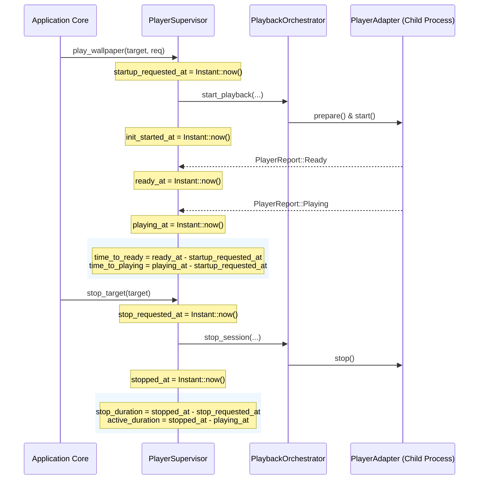

# Playback Performance Profiling, Runtime Diagnostics & Resource Monitoring

**Phase:** Phase 6, Wallpaper Playback Engine & Player Lifecycle  
**Step:** 37 of 90  
**Status:** Implemented & Verified  

---

## 1. Overview & Architectural Principles

KinetiWall Step 37 establishes a lightweight, local-only observability and diagnostics layer across the playback architecture. The observability subsystem provides deterministic visibility into wallpaper startup performance, runtime health, process resource consumption, lifecycle milestone timings, and recovery events without destabilizing live playback or compromising user privacy.

### Core Architectural Principles

1. **Local-Only & Zero-Exfiltration**:
   - All diagnostics, timing metrics, and resource samples remain strictly local in memory.
   - Zero telemetry, analytics SDKs, cloud endpoints, or external network requests are permitted.
2. **Privacy by Design**:
   - Raw operating system filesystem paths (`C:\...`, `/Users/...`) and unredacted media file paths are strictly forbidden in exported diagnostic payloads.
   - Diagnostic exports serialize only authoritative IDs (`DisplayTargetId`, `PlayerInstanceId`, `PlaybackSessionId`, `WallpaperId`), typed lifecycle states, duration metrics, and statistical summaries.
3. **Bounded Memory & Allocation Guarantees**:
   - Event and sample retention are bounded by strict constants (`MAX_RETAINED_EVENTS = 100`, `MAX_RETAINED_SAMPLES = 60`).
   - Ring buffers utilize FIFO (first-in, first-out) eviction to prevent memory accumulation during long-running sessions.
4. **Safety & Zero-Cost Isolation**:
   - The central orchestrator and supervision layer (`kinetiwall-playback`) strictly enforces `#![forbid(unsafe_code)]`.
   - Native Windows API process inspection (`K32GetProcessMemoryInfo`, `GetProcessTimes`) is cleanly encapsulated in adapter-side platform sampling modules (`kinetiwall-player-video::sampler`, `kinetiwall-player-web::sampler`).
   - Process metric sampling utilizes non-invasive Windows handles opened with `PROCESS_QUERY_LIMITED_INFORMATION`, eliminating privilege escalation and thread locking.

---

## 2. Diagnostics Data Model

### 2.1 Diagnostic Categories (`DiagnosticCategory`)

The diagnostic pipeline categorizes every lifecycle milestone and failure condition through a strongly typed enum:

| Category | Description |
| :--- | :--- |
| `StartupRequested` | Controller received a play request and initiated player launch. |
| `BackendInitStarted` | Player adapter commenced process spawn or IPC initialization. |
| `BackendReady` | Player backend confirmed readiness to render. |
| `PlaybackStarted` | First frame rendered / active playback confirmed. |
| `PlaybackSuspended` | Playback paused or suspended (e.g. occlusion, low power). |
| `PlaybackResumed` | Playback resumed from suspended state. |
| `PlaybackStopped` | Graceful stop command issued and confirmed. |
| `InitTimedOut` | Backend failed to signal readiness before startup deadline expired. |
| `BackendReportedError` | Backend emitted an asynchronous unrecoverable playback error. |
| `IpcConnectionLost` | IPC pipe between controller and worker process broke unexpectedly. |
| `ProcessExitedUnexpectedly` | Child player worker process terminated without clean shutdown. |
| `RecoveryAttemptStarted` | Supervisor triggered bounded auto-recovery restart. |
| `RecoveryCompleted` | Supervisor confirmed successful restart and playback resumption. |
| `RecoveryExhausted` | Auto-recovery retry budget exceeded; target moved to dead state. |
| `ShutdownStarted` | Subsystem shutdown initiated across targets. |
| `ShutdownCompleted` | All worker processes and resources cleanly released. |
| `ResourceCleanupFailed` | Residual process handle or temp resource cleanup encountered failure. |
| `MeasurementUnavailable` | Resource or timing probe was not available or supported. |

### 2.2 Diagnostic Event Structure (`DiagnosticEvent`)

Each event captures:
- `event_id`: Unique UUIDv4 identifier.
- `instance_id`: Unique instance generation token for the supervised player.
- `session_id`: Authoritative playback session ID.
- `target_id`: Display target index (`DisplayTargetId(0)`, etc.).
- `wallpaper_id`: Wallpaper catalog ID.
- `wallpaper_type`: `Video` or `Web`.
- `category`: Strongly typed `DiagnosticCategory`.
- `timestamp_millis`: Wall-clock UNIX timestamp in milliseconds.
- `detail`: Optional privacy-safe detail string.
- `duration_ms`: Optional milestone duration in milliseconds.

---

## 3. Playback Lifecycle Timings (`LifecycleTimings`)

Accurate measurement of startup latency and stop execution times is crucial to identify slow decoders, WebView2 initialization stalls, or filesystem contention.

All timings are recorded using high-resolution monotonic clocks (`std::time::Instant`):



### Milestone Calculation Semantics

- **Time to Ready (`time_to_ready`)**: Duration from `startup_requested_at` to `ready_at`.
- **Time to Playing (`time_to_playing`)**: Duration from `startup_requested_at` to `playing_at`.
- **Active Duration (`active_duration`)**: Duration while in the active playing state until graceful stop, unexpected crash, or elapsed wall-clock time if still playing.
- **Stop Duration (`stop_duration`)**: Duration required for `stop()` to terminate the session and confirm process teardown.
- **Failure Isolation**: If startup fails or crashes before reaching `Playing`, `time_to_playing` evaluates to `None`, and `has_failed` is marked `true`.

---

## 4. Resource Monitoring & Process Sampling

### 4.1 Process Resource Sample (`ProcessResourceSample`)

Every sampling interval (driven by supervisor tick), active worker processes are measured:

- `timestamp_millis`: Epoch millisecond timestamp.
- `pid`: OS process ID of the child player worker.
- `cpu_percent`: CPU utilization percentage across all system cores ($0.0\%$ to $100.0\%$). Evaluates to `None` on the initial sample (as calculating CPU utilization requires an elapsed delta $\Delta t$).
- `working_set_bytes`: Physical resident memory currently mapped to the process (`K32GetProcessMemoryInfo` -> `WorkingSetSize`).
- `private_memory_bytes`: Committed memory private to the process (`K32GetProcessMemoryInfo` -> `PrivateUsage`).
- `thread_count`: Number of active OS threads in the child worker process.

### 4.2 Windows FFI Non-Invasive Sampler

The process sampler runs in `kinetiwall-player-video` and `kinetiwall-player-web`:

```rust
// Open process with limited query rights (requires no elevation, causes zero lock contention)
let handle = OpenProcess(PROCESS_QUERY_LIMITED_INFORMATION, 0, pid);

// Query memory statistics via kernel32/psapi
let mut mem = ProcessMemoryCountersEx::default();
K32GetProcessMemoryInfo(handle, &mut mem as *mut _, size_of::<ProcessMemoryCountersEx>() as u32);

// Calculate CPU % from user + kernel CPU times over elapsed wall-clock time
let cpu_time_delta = (user_time + kernel_time) - prev_cpu_time;
let wall_time_delta = now - prev_sample_instant;
let cpu_percent = (cpu_time_delta as f64 / (wall_time_delta.as_micros() * num_cpus) as f64) * 100.0;
```

---

## 5. In-Memory Aggregation & Diagnostics Snapshot

### 5.1 Diagnostics Aggregator (`DiagnosticsAggregator`)

Each supervised target maintains an isolated `DiagnosticsAggregator`:
- **Bounded Event Ring Buffer**: Retains the most recent `MAX_RETAINED_EVENTS` (100) events.
- **Bounded Sample Ring Buffer**: Retains the most recent `MAX_RETAINED_SAMPLES` (60) resource samples (1 sample/sec = 1 minute of telemetry).
- **Statistical Summarizer**: Computes peak working set, peak private commit, latest memory, and average CPU utilization (correctly excluding unmeasured/`None` intervals).
- **Crash & Recovery Counters**: Tracks lifetime failures and successful recovery attempts across the target's lifecycle.

### 5.2 Diagnostics Snapshot Format (`DiagnosticsSnapshot`)

```json
{
  "instance_id": "a3bb189e-8bf9-4888-9912-10f72f009e4f",
  "session_id": "76e33bd1-f925-4556-91e8-d6174a7bca02",
  "target_id": 0,
  "wallpaper_id": "9b1deb4d-3b7d-4bad-9bdd-2b0d7b3dcb6d",
  "wallpaper_type": "video",
  "health_status": "healthy",
  "timings": {
    "time_to_ready_ms": 115,
    "time_to_playing_ms": 182,
    "active_duration_ms": 64200,
    "stop_duration_ms": null,
    "has_failed": false
  },
  "latest_sample": {
    "timestamp_millis": 1731566400000,
    "pid": 14208,
    "cpu_percent": 3.8,
    "working_set_bytes": 48234496,
    "private_memory_bytes": 31457280,
    "thread_count": 6
  },
  "resource_summary": {
    "sample_count": 60,
    "average_cpu_percent": 4.1,
    "peak_working_set_bytes": 52428800,
    "peak_private_memory_bytes": 33554432,
    "latest_working_set_bytes": 48234496
  },
  "backend_metrics": {
    "hwdec_current": "d3d11va",
    "media_load_ms": 78,
    "web_navigation_ms": null,
    "audio_frames_delivered": 0
  },
  "recovery_attempts": 0,
  "recent_events": [
    {
      "event_id": "...",
      "category": "startup_requested",
      "timestamp_millis": 1731566335800
    },
    {
      "event_id": "...",
      "category": "playback_started",
      "timestamp_millis": 1731566335982,
      "duration_ms": 182
    }
  ]
}
```

---

## 6. Retention on Target Stop & Recovery

When a target is stopped via `PlayerSupervisor::stop_target()`:
1. `stop_requested_at` and `stopped_at` are recorded.
2. The `PlaybackStopped` diagnostic event is emitted with `stop_duration_ms`.
3. An authoritative `DiagnosticsSnapshot` is built and retained in `PlayerSupervisor::recent_snapshots`.
4. Subsequent calls to `diagnostics_snapshot(target)` or `export_diagnostics_json(target)` retrieve the post-mortem record until a new wallpaper session is initiated on that display target.

When auto-recovery restarts a crashed player:
1. `ProcessExitedUnexpectedly` is logged to the target's aggregator.
2. `RecoveryAttemptStarted` is logged with the retry attempt counter.
3. The replacement player process is spawned with a fresh `PlayerInstanceId`.
4. The historical event ring buffer is preserved so post-recovery diagnosis retains full visibility into the root cause of the previous failure.

---

## 7. Verification & Test Suite

The test suite in [diagnostics_tests.rs](file:///E:/Projects/All%20working%20projects/App%20projects%20working/KinetiWall%20Engine%20(working)/crates/kinetiwall-playback/tests/diagnostics_tests.rs) verifies:

1. `test_diagnostic_event_and_category_semantics`: Event construction, categories, and field mapping.
2. `test_lifecycle_timings_measurement`: Accurate calculation of `time_to_ready`, `time_to_playing`, `active_duration`, and `stop_duration`.
3. `test_lifecycle_timings_failure_handling`: Verifies unreached milestones return `None` and flag `has_failed: true`.
4. `test_bounded_diagnostics_aggregator_fifo_eviction`: Strict bounds enforcement for 100 events and 60 samples under heavy load.
5. `test_resource_summary_statistics`: Average CPU %, peak memory, and proper omission of unmeasured intervals.
6. `test_supervisor_emits_startup_and_stop_diagnostics`: End-to-end milestone emission through supervisor start and stop cycles.
7. `test_supervisor_records_process_crash_and_recovery_diagnostics`: Event sequence verification across crash detection and recovery restarts.
8. `test_supervisor_records_startup_timeout_diagnostics`: Timeout detection and failure recording.
9. `test_adapter_metrics_collection_and_snapshot`: Polling integration and metric extraction from adapters.
10. `test_diagnostics_privacy_and_json_export`: JSON serialization and complete absence of raw filesystem paths or drive letters.
11. `test_unrecovered_process_crash_diagnostics`: Crash recording when recovery budget is zero.
12. `test_session_switch_diagnostics_isolation`: Isolation between consecutive wallpaper sessions on the same display target.

