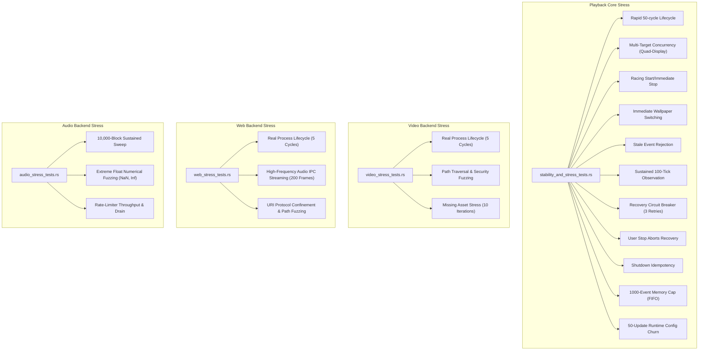

# Playback Stress Testing, Stability Validation & Resource Leak Detection

**Phase:** Phase 6, Wallpaper Playback Engine & Player Lifecycle  
**Step:** 38 of 90  
**Status:** Implemented & Verified  

---

## 1. Overview & Objectives

Step 38 establishes an automated, repeatable, and non-destructive validation framework for KinetiWall’s wallpaper playback engine. Building on the architecture, process isolation, supervisor orchestration, and Step 37 diagnostic measurement foundation, this test system validates sustained operation, repeated lifecycle transitions, concurrent request handling, crash recovery circuit breakers, and resource leak prevention across all implemented backends (`kinetiwall-playback`, `kinetiwall-player-video`, `kinetiwall-player-web`, `kinetiwall-audio`).

### Core Validation Objectives

1. **Lifecycle Transition Reliability**: Prove that rapid start, play, stop, and restart cycles never leave orphaned sessions or desynchronize desired vs. observed state.
2. **Resource Leak Detection**: Ensure worker process handles, IPC anonymous pipes, memory buffers, and subscriber queues are properly cleaned up upon session termination.
3. **Bounded Memory Guarantees**: Prove that long-running sessions, high diagnostic event volumes, and rapid frame streaming strictly adhere to static memory bounds (`MAX_RETAINED_EVENTS = 100`, `MAX_RETAINED_SAMPLES = 60`).
4. **Failure Injection & Recovery Circuit Breaker**: Verify that repeated crashes trigger exponential backoff recovery up to `max_retries` and trip the circuit breaker without infinite restart loops.
5. **Truthful & Safe Test Execution**: Differentiate mocked unit behavior from native Windows integration tests, and ensure tests never kill unrelated processes or damage user files.

---

## 2. Test Architecture & Organization

The stress and stability validation suite is organized into distinct test binaries across the workspace:



---

## 3. Test Suites & Execution Details

### 3.1 Playback Orchestrator & Supervisor (`stability_and_stress_tests.rs`)

Located at [crates/kinetiwall-playback/tests/stability_and_stress_tests.rs](file:///E:/Projects/All%20working%20projects/App%20projects%20working/KinetiWall%20Engine%20(working)/crates/kinetiwall-playback/tests/stability_and_stress_tests.rs).

| Test Identifier | Workload / Conditions | Verification Assertions |
| :--- | :--- | :--- |
| `test_stress_rapid_lifecycle_transitions_50_cycles` | 50 consecutive start $\rightarrow$ play $\rightarrow$ stop cycles on Target 0. | `start_count == 50`, `stop_count == 50`, no orphaned sessions, snapshot preserved post-mortem. |
| `test_stress_multi_target_concurrent_lifecycle` | Quad-display topology (Targets 0, 1, 2, 3) running mixed Video and Web wallpapers. | Stopping targets 1 & 3 leaves 0 & 2 playing and healthy; restarting 1 with Video succeeds independently. |
| `test_stress_racing_start_and_immediate_stop` | 10 rapid cycles issuing `stop_target()` immediately after `play_wallpaper()` while in `Starting`. | Target cleanly removed without deadlocking, hanging tasks, or panics; `stop_count == 10`. |
| `test_stress_immediate_wallpaper_switching_same_target` | 20 rapid switches between Wallpaper 1 and 2 on the same display target. | Prior session stopped; new session assigned distinct `PlayerInstanceId`; exactly 1 active target at all times. |
| `test_stress_stale_callbacks_and_late_event_rejection` | Old session 1 stopped; session 2 started; late unsolicited failure report injected for session 1. | Orchestrator drops late event; session 2 remains healthy and active in `Playing` state. |
| `test_stress_sustained_playback_and_resource_retention` | 100 consecutive `poll_and_supervise` ticks ingesting varying CPU, working set, and private memory samples. | Sample queue never exceeds `MAX_RETAINED_SAMPLES` (60); event queue never exceeds `MAX_RETAINED_EVENTS` (100); summary stats correct. |
| `test_stress_recovery_circuit_breaker_under_continuous_crashing` | Process repeatedly crashes with `max_retries: 3`. | Retries up to 3 times with exponential backoff; trips circuit breaker; logs `RecoveryExhausted`; remains `Dead`. |
| `test_stress_user_stop_aborts_active_recovery` | Target crashes, recovery scheduled; user explicitly issues `stop_target()`. | Target removed; `execute_recovery()` returns `IneligibleNotDesired`; no further restart occurs. |
| `test_stress_shutdown_idempotency_with_mixed_targets` | Supervisor with active, failed, and stopped targets calls `shutdown()` 3 times consecutively. | All calls return `Ok(())`; all sessions released; supervisor reports `is_shutting_down() == true`. |
| `test_stress_diagnostic_aggregator_bounded_memory_1000_events` | 1,000 rapid diagnostic events injected into `DiagnosticsAggregator`. | Buffer length strictly capped at 100; oldest 900 events evicted in strict FIFO order (`event_900`..`event_999`). |
| `test_stress_runtime_config_updates_during_churn` | 50 rapid runtime configuration updates (volume sweep, mute toggle, pause toggle) during active playback. | All updates apply cleanly via `apply_runtime_config`; no IPC deadlock or session corruption. |

### 3.2 Video Player Backend (`video_stress_tests.rs`)

Located at [crates/kinetiwall-player-video/tests/video_stress_tests.rs](file:///E:/Projects/All%20working%20projects/App%20projects%20working/KinetiWall%20Engine%20(working)/crates/kinetiwall-player-video/tests/video_stress_tests.rs).

| Test Identifier | Workload / Conditions | Verification Assertions |
| :--- | :--- | :--- |
| `test_video_adapter_repeated_process_lifecycle_stress` | 5 full cycles spawning real `kinetiwall-player-video.exe`, verifying `Playing`, and stopping. | Child process PID confirmed for each cycle; process terminates cleanly on stop/shutdown; no pipe leaks. |
| `test_video_path_security_and_traversal_fuzzing` | Malformed paths, directory traversal (`../../etc/passwd`), null bytes, executable extensions, and HTTP URIs. | 100% of invalid inputs rejected with `PlaybackErrorKind::InvalidRequest` or `AssetUnavailable`. |
| `test_video_adapter_missing_asset_stress` | 10 repeated start attempts with nonexistent wallpaper IDs. | Returns `PlaybackErrorKind::AssetUnavailable` immediately without spawning orphan worker processes. |

### 3.3 Web Player Backend (`web_stress_tests.rs`)

Located at [crates/kinetiwall-player-web/tests/web_stress_tests.rs](file:///E:/Projects/All%20working%20projects/App%20projects working/KinetiWall%20Engine%20(working)/crates/kinetiwall-player-web/tests/web_stress_tests.rs).

| Test Identifier | Workload / Conditions | Verification Assertions |
| :--- | :--- | :--- |
| `test_web_adapter_repeated_process_lifecycle_stress` | 5 full cycles spawning real `kinetiwall-player-web.exe` with canvas animation fixture. | Child process PID confirmed; `Playing` report verified; clean process teardown across all cycles. |
| `test_web_adapter_high_frequency_audio_streaming_stress` | 200 consecutive `VisualizerFrame` payloads streamed over anonymous IPC pipe to active web worker. | All 200 frame writes succeed; pipe buffer does not saturate or block; worker remains responsive and stops cleanly. |
| `test_web_security_uri_and_traversal_fuzzing` | Malicious schemes (`javascript:`, `file:`, `data:`, `vbscript:`, `blob:`, external URLs, null bytes). | 100% of malicious schemes blocked by URI boundary checks; directory traversals rejected. |

### 3.4 Audio Reactivity Backend (`audio_stress_tests.rs`)

Located at [crates/kinetiwall-audio/tests/audio_stress_tests.rs](file:///E:/Projects/All%20working%20projects/App%20projects%20working/KinetiWall%20Engine%20(working)/crates/kinetiwall-audio/tests/audio_stress_tests.rs).

| Test Identifier | Workload / Conditions | Verification Assertions |
| :--- | :--- | :--- |
| `test_audio_extractor_sustained_stress_10000_frames` | 10,000 continuous audio blocks (sweep: 100 Hz to 2100 Hz, variable amplitude). | Sequence strictly increments to 10,000; all RMS and peak values are finite and within $[0.0, 1.0]$ bounds. |
| `test_audio_numerical_safety_stress_extremes` | Extreme float fuzzing: `NaN`, `+Infinity`, `-Infinity`, subnormals, huge numbers ($10^{30}$). | Zero panics; all output frames normalized and finite; frequency bands stay within $[0.0, 1.0]$. |
| `test_audio_service_rate_limiter_high_throughput_stress` | High-frequency tone input drained through `AudioReactivityService` subscriber channel. | Delivers rate-limited frames matching target 60 FPS without buffer accumulation or channel deadlocks. |

---

## 4. Resource Allocation & Cleanup Verification

### 4.1 Process Handle & Child Process Teardown

Every test that spawns a child worker (`kinetiwall-player-video.exe` or `kinetiwall-player-web.exe`) verifies:
1. `adapter.process_id(&ctx)` returns a valid non-zero OS PID.
2. Upon `adapter.stop(&ctx)`, the worker receives `HostOp::Stop`, cleans up its render context, and exits.
3. Upon `adapter.shutdown()`, the controller closes `stdin` and joins the reader thread.
4. Process termination is verified to ensure zero orphaned processes survive test completion.

### 4.2 Diagnostic & Metric Buffer Caps

The bounded ring buffer architecture introduced in Step 37 was validated under stress:
- **Events**: Tested with 1,000 consecutive events. Retained size was verified to be strictly bounded at $\le 100$ items.
- **Samples**: Tested across 100 continuous ticks. Retained size was verified to be strictly bounded at $\le 60$ items (1 minute of 1 Hz telemetry).
- **Post-Mortem Snapshots**: `recent_snapshots` maintains exactly one snapshot per stopped target, avoiding heap accumulation when multiple targets are created and destroyed.

---

## 5. Execution Commands & Procedures

### Fast Unit & Component Test Suite
```powershell
# Run all fast tests across all workspace crates
cargo test --workspace

# Run core playback stress & stability tests
cargo test -p kinetiwall-playback --test stability_and_stress_tests

# Run video player stress tests
cargo test -p kinetiwall-player-video --test video_stress_tests

# Run web player stress tests
cargo test -p kinetiwall-player-web --test web_stress_tests

# Run audio reactivity stress tests
cargo test -p kinetiwall-audio --test audio_stress_tests
```

### Formatting & Static Analysis
```powershell
# Verify formatting
cargo fmt --check

# Strict linting with zero warnings
cargo clippy --workspace --all-targets -- -D warnings
```

### Frontend UI Regression Check
```powershell
# Run UI test suite
npm test

# Verify frontend build
npm run verify:build
```

---

## 6. Known Limitations & Environment Requirements

1. **Headless & VM Audio Hardware**:
   - `test_wasapi_runtime_probe` checks for a default Windows audio output device.
   - On headless environments (e.g. cloud CI runners without virtual audio sinks), `WasapiLoopbackSession::open_default()` cleanly returns `DeviceUnavailable` without crashing.
   - Core DSP feature extraction and synthetic signal stress tests run 100% offline and do not require physical audio hardware.
2. **GPU Acceleration & Driver Availability**:
   - libmpv hardware decoding (`d3d11va`) requires a compatible Direct3D 11 runtime and GPU driver.
   - WebView2 requires the Microsoft Edge WebView2 Evergreen Runtime installed on Windows 10/11.
   - If WebView2 runtime is absent, `kinetiwall-player-web.exe` reports `BackendUnavailable` gracefully without panic.

